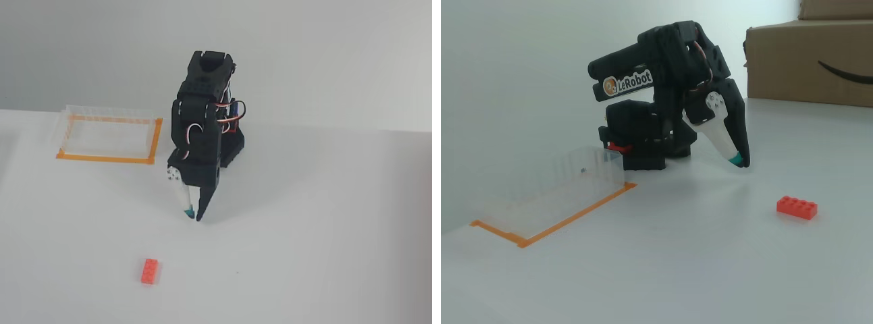
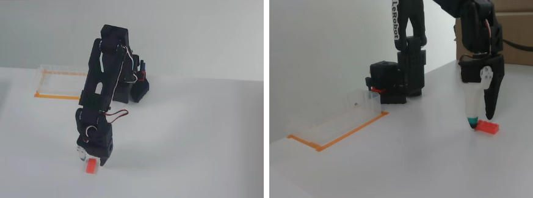
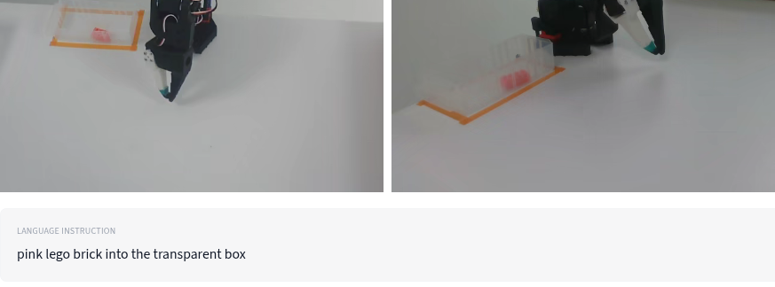

# Day 11: Label quality ✅ (Oct 9, 2026)

## Goal
The task label can lie: it might say "red cube" while the video shows a blue one. Today is the **human part** of auditing: **no code**. You watch the videos and judge whether the label matches what really happens, and you time yourself so you know how long manual review takes.

The label for this dataset: **"pink lego brick into the transparent box"**.

## The viewer
The LeRobot dataset viewer plays each try's videos next to its joint graphs.
- Working link: `https://lerobot-visualize-dataset.hf.space/lerobot/svla_so101_pickplace/episode_N` (change `N` to the try number, e.g. `episode_0`).
- The `huggingface.co/spaces/lerobot/visualize_dataset?path=...` page also works (it wraps the same viewer).

## Episode 0, walked through together
I asked the coach to open it on his computer. He opened try 0 and took 3 screenshots. In each one, the **up** camera (looking down from above) is on the left and the **side** camera is on the right.

**Start:** a pinkish-red Lego brick sits on a white table, the transparent box is empty, and the gripper is raised and open.

**Middle:** the gripper is grasping the brick.

**End:** the brick is inside the transparent box, and the arm is back at rest.

Cameras: both up and side are clear, with nothing blocking them. Small note: in the side view, the robot base partly hides one corner of the box. That's normal and doesn't block the task.

**Example verdict for try 0:**

| Question | Answer |
|---|---|
| Is the brick pink? | ✅ Yes |
| Does it end inside the box? | ✅ Yes |
| Are the cameras clear? | ✅ Yes |
| **Label matches?** | ✅ **Yes** |

## The 3 questions for every try
1. **Is the brick pink?** (right object)
2. **Does it end inside the transparent box?** (task finished, right place)
3. **Are the cameras clear?** (nothing blocking the view)

All 3 yes = the label matches.

## My verdict on tries 1, 2 and 3
> "my verdict for ep 1,2 and 3 the brick is pink ,it ends inside the transparent box and the cameras are clear and the label matches as well"

| Try | Pink? | In the box? | Cameras clear? | Label matches? |
|---|---|---|---|---|
| 0 (with coach) | ✅ | ✅ | ✅ | ✅ |
| 1 | ✅ | ✅ | ✅ | ✅ |
| 2 | ✅ | ✅ | ✅ | ✅ |
| 3 | ✅ | ✅ | ✅ | ✅ |

## Time: video length vs review time
**First answer:** I gave the video lengths, reading them off the graph in the viewer. The coach checked them against the data (frames ÷ 30):

| Try | Video length (my read) | Data check |
|---|---|---|
| 1 | 8.9 s | 266 ÷ 30 = 8.9 s ✅ |
| 2 | 7.7 s | 230 ÷ 30 = 7.7 s ✅ |
| 3 | 6.1 s | 183 ÷ 30 = 6.1 s ✅ |

**But that's not review time.** Video length is how long the clip plays. **Review time** is how long **I** spend on one try: opening it, watching, rewinding, looking at both cameras, deciding, and writing the verdict. That's usually **30–60 seconds** per try.

**My estimate: about 40 seconds per try.**

| Dataset size | Math | Review time |
|---|---|---|
| 50 tries | 50 × 40 s = 2,000 s | ≈ **33 minutes** |
| 500 tries | 500 × 40 s = 20,000 s | ≈ **5.5 hours** |

## Key ideas
- Label review can't be done with numbers alone; a human has to look.
- Use the same 3 questions on every try, so the verdicts are fair and fast.
- Only 4 tries were checked by eye, so the report should say "4 of 50 sampled", not "all 50".

## Checklist progress
- #1 Episode count: ✅ automated (Day 8)
- #2 Frame count / no empty tries: ✅ automated (Day 8)
- #4 Timing: ✅ automated (Day 9)
- #7 Robot moves: ✅ automated (Day 10)
- #8 Camera clear: 👀 checked **by hand** on 4 tries (0–3), all clear
- #9 Task finished: 👀 seen in the same 4 tries, all finished
- #10 Label correct: 👀 checked **by hand** on 4 tries (0–3), all match

## Next: Day 12
Empty and junk episodes: measure how much each try moves in total, list the 5 lowest, and watch one flagged video.
