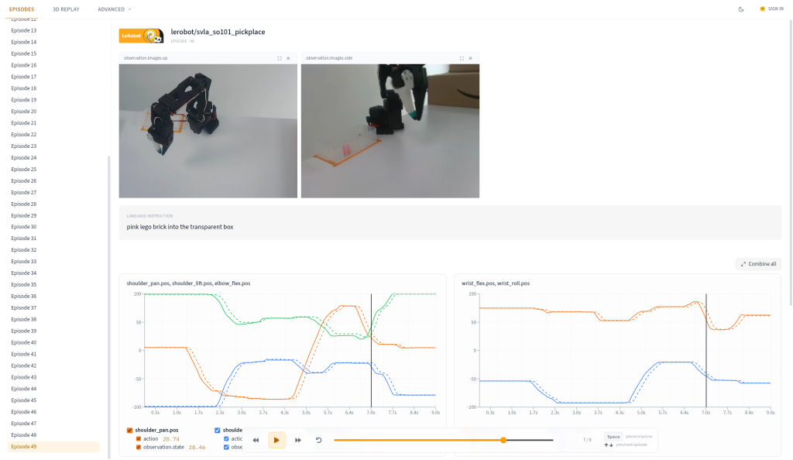
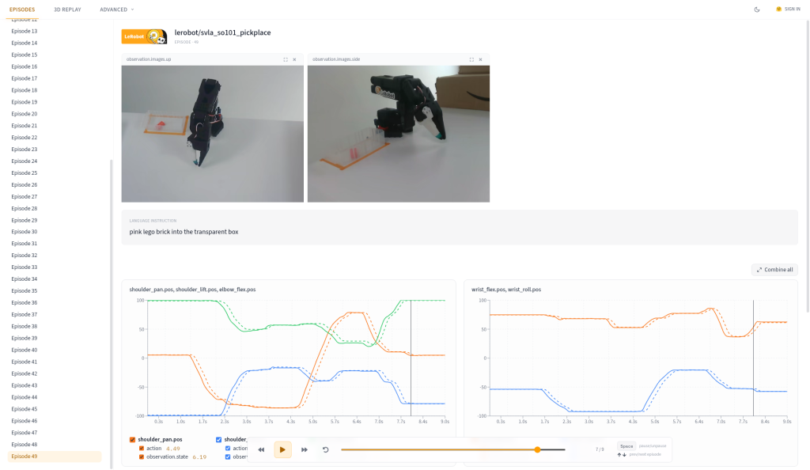
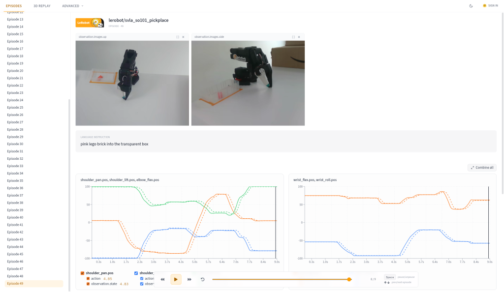
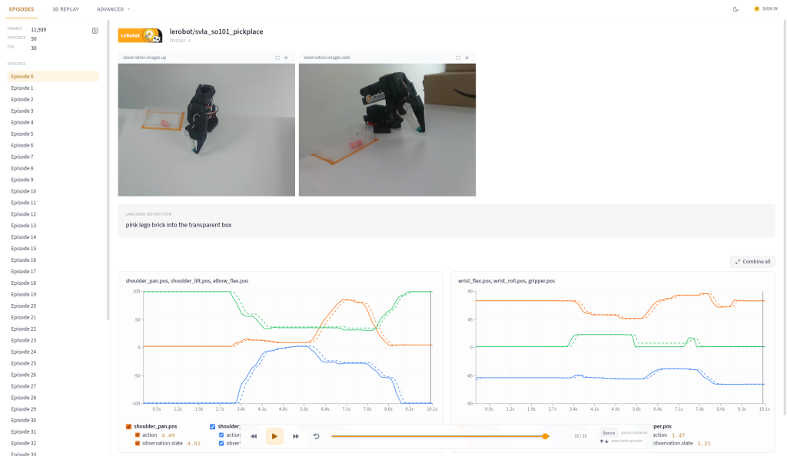

# Day 17: Truncated episodes ✅ (Oct 10, 2026)

## Goal
Tries that get cut off mid-grasp teach the robot to give up halfway. Look at how each try **ends**, flag tries whose final pose looks unusual, and then **watch** the flagged one to decide. This is checklist **#9 (task finished)**, as a **heuristic** (a smart guess), not proof.

## Analogy: a movie cut off too early
A movie that ends right before the hero catches the ball. You never see the catch, so you don't know if it happened. A truncated try is the same: the recording stops before the task is done.
**The check is a hint, not proof.** Numbers can say "this ending looks odd"; only watching tells you if it's really cut off.

## Step 1: Grab the last frame of every try
In Terminal: `conda activate lerobot`, then `python` (wait for `>>>`). Load `df` and `names` as before (Day 12), then:
```python
last = df.groupby("episode_index").tail(1)
end = pd.DataFrame(last["observation.state"].tolist(), columns=names, index=last["episode_index"])
print(end.describe().round(1))
```
1. `df.groupby("episode_index").tail(1)`: for each try, keep only its **last row** (the final moment). 50 tries → 50 rows.
2. `end = pd.DataFrame(...)`: unpack the 6 real joint positions (`observation.state`) into named columns, and label each row with its try number (`index=...`).
3. `end.describe().round(1)`: summary of **where the 50 tries ended**, per joint.

## Step 2: Read the end-pose summary
| | shoulder_pan | shoulder_lift | elbow_flex | wrist_flex | wrist_roll | gripper |
|---|---|---|---|---|---|---|
| mean | 2.8 | -98.2 | 99.0 | 73.4 | -55.8 | 1.5 |
| std | 4.0 | 2.8 | 0.2 | 2.0 | 4.0 | 0.6 |
| min | -4.0 | -98.9 | 98.7 | **61.3** | -63.3 | 1.2 |
| 25% | -0.3 | -98.7 | 98.9 | 73.4 | -58.7 | 1.3 |
| 50% | 2.6 | -98.6 | 99.0 | 73.8 | -56.2 | 1.5 |
| 75% | 5.5 | -98.5 | 99.0 | 74.3 | -53.2 | 1.5 |
| max | **15.0** | **-79.0** | 99.4 | 74.7 | -46.6 | 5.2 |

**"Explain like a baby": 50 kids going back to their seats.** At the end of class every kid sits back down. If they all sit in almost the same spot, the **std (spread) is small**. Here most spreads are tiny (elbow_flex 0.2!), so almost every try ends in the same place.

**A normal end** = arm **folded home** (shoulder_lift ≈ -98.6, elbow_flex ≈ 99) and **gripper closed** (≈ 1.5).

**Suspects** (numbers far from where most tries end):
- shoulder_lift **max -79.0** (most end at about -98.6)
- shoulder_pan **max 15.0** (most end at about 2.6)
- wrist_flex **min 61.3** (most end at about 73.8)

## My question: "Why is -79 in the max row next to 74.7, -46.6, 5.2 and 15?"
**Each column is its own list.** The max row picks the biggest number **in each column separately**, so those numbers can come from **different tries**.
- First explanation: in a class, the tallest kid, the oldest kid and the fastest kid can be three different kids. A "max" row would list the tallest height, the oldest age and the fastest time, from three different children.
- Simpler: the max row is **not one try**. It's the "record" for each joint, and each record can belong to a different try.

**My insight: "so this table is not for one try."** ✅ Right: it's a **summary of all 50 tries**.

## Step 3: Find which try is the suspect
```python
print(end.sort_values("shoulder_lift", ascending=False).head(3).round(1))
```
`sort_values("shoulder_lift", ascending=False)` puts the try with the **highest** (least negative) shoulder_lift at the top; `.head(3)` shows the top 3.

| Try | shoulder_pan | shoulder_lift | elbow_flex | wrist_flex | wrist_roll | gripper |
|---|---|---|---|---|---|---|
| **49** | 4.8 | **-79.0** | 99.4 | **61.3** | -57.7 | 1.7 |
| 45 | -0.8 | -97.3 | 99.3 | 73.4 | -53.6 | 1.3 |
| 29 | 2.1 | -97.4 | 99.1 | 73.4 | -52.3 | 1.5 |

**Try 49 is the only suspect.** Try 45 and try 29 end like everyone else. Try 49 is also the **last try** of the whole recording, a classic spot for "someone hit stop a bit early".

## My question: "So the number should be higher?"
Not exactly. For shoulder_lift, **home is more negative** (-98.6 = arm lowered all the way). -79 means the shoulder is **still a bit lifted**.
**The rule is "different from where most tries end"**, not "higher" or "lower". Each joint has its own normal end spot; we look for tries far from it in either direction.

## Step 4: Watch it (the verdict)
I watched try 49 in the viewer: `https://lerobot-visualize-dataset.hf.space/lerobot/svla_so101_pickplace/episode_49`

What I saw:
> "the arm is a little lean toward to right side"

> "the brick end up inside the box , not moving still ,it resting"

The coach checked the same try with screenshots and compared it to try 0:

**Try 49, 2 seconds before the end**


**Try 49, 1 second before the end**


**Try 49, last frame**


**Try 0, last frame (a normal ending, for comparison)**


What the coach found:
- **The brick is in the box.** ✅ Task done.
- **The arm has been at rest since about 8.2 s**, and the try is 9.0 s long. The robot finished and stood still for almost a second before the recording stopped, so it wasn't cut off mid-move.
- Compared to try 0, it's **not turned** (shoulder_pan 4.8 vs 4.5), but the **shoulder isn't fully lowered** (about -78 vs about -100). It sits a bit **higher and more upright**, which can look like a lean.

**Verdict: NOT truncated.** ✅
Minor report note: "Ep 49 ends in a slightly different rest pose; task complete."

## Lesson
**The code gives a hint; your eyes give the verdict.**

## In my words (checked)
> "The cut off ep means the video is stop before the task was finished and because the number look a little off so we have to check the video to confirm it"

Feedback: **exactly right** ✅.

## Added to the tool: check_endings() with REVIEW
`audit_checks_v1.py` now has a 7th check, `check_endings(df, names)` (the script is now 432 lines). Because it's a hint, it never says FAIL; it says **REVIEW** and lists the tries to watch.

How it decides, per joint:
1. **Typical end** = the median of all 50 last poses (the middle kid's seat).
2. **Usual spread** = a "robust" spread: the median distance from the median (×1.4826 so it's on the same scale as std). Robust means one odd try can't stretch it.
3. A try is flagged if a joint is **more than 4× the usual spread AND more than 10 points** away from the typical end.
   - The **10 points** stops tiny wiggles from being flagged on joints that barely vary (gripper spread is 0.0, so 4× spread alone would flag almost anything).
   - The **4×** stops normal variety from being flagged on joints that naturally end in different places (shoulder_pan, wrist_roll).
   - Both rules live in the thresholds block: `END_SPREAD_X = 4.0`, `END_MIN_POINTS = 10.0`.

In the summary: `REVIEW` doesn't fail OVERALL, but it's printed clearly, with a "*** HUMAN REVIEW NEEDED" line underneath.

Output on svla_so101_pickplace:
```
========================================================================
ROBOT DATASET AUDIT: automated checks (audit_checks_v1)
========================================================================
Dataset:    lerobot/svla_so101_pickplace
Robot type: so100_follower
Episodes:   50   Frames: 11939   FPS: 30
Joints:     shoulder_pan, shoulder_lift, elbow_flex, wrist_flex, wrist_roll, gripper
------------------------------------------------------------------------
PASS   #1-2 Episodes       all 50 tries present (0-49), none empty, shortest 183 frames
PASS   #4   Timing         steady at 30 fps (avg step 0.03333 s, biggest 0.03333 s), 0 skipped frames
PASS   #5   Sync           2 cameras in sync (side max gap 0.000 s, up max gap 0.000 s), 0 tries over 0.5 s
SKIP   #5b  Videos         skipped (run with --videos)
PASS   #7   Actions        no dead joints in any try; clipping under 1% (highest: elbow_flex 0.7%)
PASS   #7   Empty tries    0 empty tries; least-moving try 24 = 77% of typical (median 860)
REVIEW #9   Endings (hint) watch 1 try, unusual end pose: try 49: shoulder_lift -79.0 (usual -98.6), wrist_flex 61.3 (usual 73.8)
------------------------------------------------------------------------
OVERALL: PASS (6/6 automated checks did not fail: 5 PASS, 1 REVIEW)
*** HUMAN REVIEW NEEDED: watch the tries listed on the REVIEW line before signing off
Not automated yet: #3 odd lengths, #6 action vs state,
#8 camera clear, #10 label correct (manual review); #9 is a hint only.
========================================================================
```
It found **exactly try 49**, the same suspect I found by hand. (We already watched it: not truncated.)

On the other two test datasets it also flags one try each to watch:

| Dataset | Flagged | Why |
|---|---|---|
| MaxT90/so101-pick-place | try 45 | gripper ends at 14.5 (usual 0.8): hand still a bit open |
| lerobot/svla_so100_pickplace | try 10 | shoulder_lift -60.9 (usual -86.7), elbow_flex 54.1 (usual 74.8), wrist_flex 60.6 (usual 72.5): arm not folded home |

Those haven't been watched yet. They're "look at this", not "bad".
Sanity check: with try 49 removed from svla, the check says `all 49 tries end in the usual pose`, so it isn't just flagging something every time.

## Key ideas
- Look at the **last frame** of every try; most tries should end in the same home pose.
- `describe()` rows mix different tries; use `sort_values` to find **which** try is odd.
- "Unusual" means far from where **most** tries end, in either direction.
- A heuristic flags; a human decides. That's why it says REVIEW, not FAIL.

## Checklist progress
- #1, #2 Episodes; #4 Timing; #5 Sync; #5b Videos (with `--videos`); #7 Robot moves: ✅ automated
- #9 Task finished: 🟡 now **partly automated** as a heuristic (REVIEW), plus watching by eye
- #3, #6: not in the tool yet
- #8, #10: manual review (Day 11)

## Next: Day 18
Calibration gaps: find out what calibration info a LeRobot dataset should carry (camera settings, robot zero positions), check 2 datasets, and write a 5-line "calibration presence" checklist.
