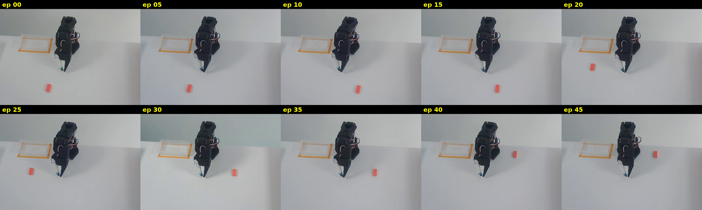
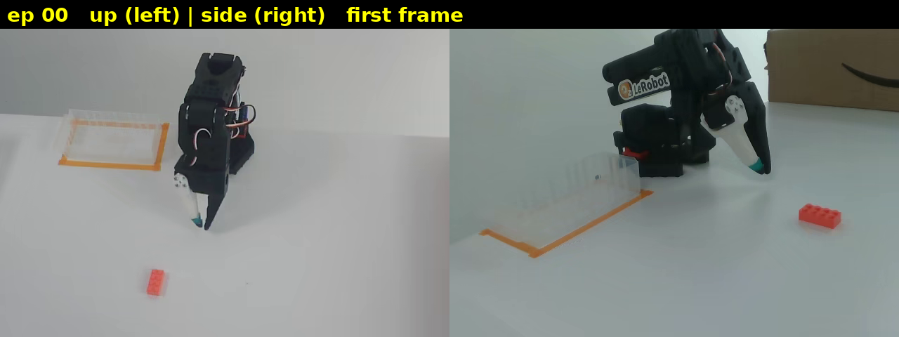
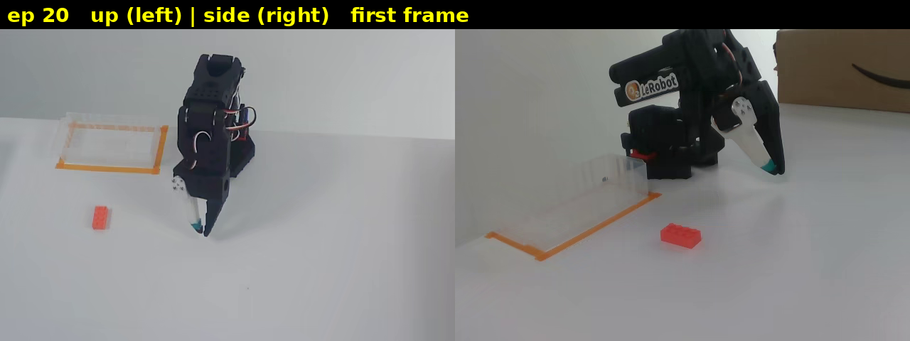
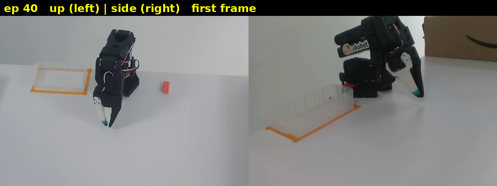

# Day 19: Edge-case coverage ✅ (Oct 10, 2026)

## Goal
100 demos of the same grasp teach the robot almost nothing new. What makes a dataset valuable is **variety**: different brick positions, different objects, different lighting. Today: look at 10 tries, tally that variety, write a **coverage rubric** (position / objects / lighting, each scored 1–3), and score one dataset (`lerobot/svla_so101_pickplace`).

This is a different kind of check. Days 8–18 asked "is the data **broken**?" Today asks "is the data **useful enough**?" That's advice, not just PASS/FAIL. It moves from **checker** to **advisor**.

## Analogy: the student who memorized one practice test
A student studies only one practice test, over and over, and memorizes every answer. They get 100% on that test. Then the real exam has **different questions**, and they fail.

A robot trained on a dataset with little variety is the same student. If the brick always starts in the same few spots, under the same light, the robot "memorizes" those spots. Move the brick somewhere new, swap it for a cup, or turn off a lamp, and it can fail.

**Coverage = how many different "questions" the robot practised on.**

## The rubric: 3 things, each scored 1–3

| Category | What we look at |
|---|---|
| **Position** | Where the object starts on the table |
| **Objects** | How many different things get picked up (shape, size, color) |
| **Lighting** | How many different light setups (bright, dim, shadows, color of light) |

### Score levels: the restaurant menu
- **1 = a restaurant with one dish.** Every visit, same meal. (One spot / one object / one light.)
- **2 = a small menu, a few dishes.** Some choice, but you'll run out fast. (A handful of spots / 2–3 similar objects / 2 light setups.)
- **3 = a big menu, many kinds of food.** Lots of real choice. (Many spots spread across the whole table, including edges / many different objects / many lighting conditions.)

Add the three scores: **3 to 9** total.
- 3–4 = narrow (robot will only work in a setup that looks like the recording)
- 5–7 = moderate
- 8–9 = broad

Full rubric: [coverage_rubric_v1.md](coverage_rubric_v1.md)

## Step 1: Get the first frames (and a lesson about tools)
The plan said "skim 10 episode videos". The web viewer (`lerobot-visualize-dataset.hf.space`) was the obvious tool, but its screenshots **weren't reliable**: it kept showing **stale frames** (an old picture left over from before, not the episode you asked for). If you score positions from the wrong picture, the whole score is wrong.

So we skipped the viewer and pulled the **first frame of each try straight from the MP4 files**.

**Lesson: verify your tools.** Before you trust a picture, a number or a viewer, make sure it really shows what you think it shows.

Script used (`/workspace/day19/grab.py` on the box, key parts below):
```python
import av, pandas as pd
from huggingface_hub import hf_hub_download
from PIL import Image, ImageDraw, ImageFont
R = "lerobot/svla_so101_pickplace"
eps = pd.read_parquet(f"hf://datasets/{R}/meta/episodes/chunk-000/file-000.parquet").set_index("episode_index")
EPS = [0, 5, 10, 15, 20, 25, 30, 35, 40, 45]
paths = {c: hf_hub_download(R, f"videos/observation.images.{c}/chunk-000/file-000.mp4", repo_type="dataset")
         for c in ["up", "side"]}

def grab(path, t):
    with av.open(path) as c:
        s = c.streams.video[0]
        c.seek(int(t / s.time_base), stream=s, backward=True, any_frame=False)
        for f in c.decode(s):
            if f.time is not None and f.time >= t - 1e-6:
                return f.to_image(), f.time

for e in EPS:
    for c in ["up", "side"]:
        t = float(eps.loc[e, f"videos/observation.images.{c}/from_timestamp"])
        im, ft = grab(paths[c], t)
        # ...paste up + side side by side, write "ep NN" on top, save frames/epNN.png
# ...then paste the 10 up frames into a 5 x 2 grid: contact_up.png
```
What each part does:
1. `hf_hub_download(...)`: download the two big video files (up camera and side camera). Remember Day 4: **all 50 tries live in one MP4 per camera**, one after another.
2. `eps.loc[e, ".../from_timestamp"]`: the **bookmark**: the second where try `e` starts inside that long video (Day 15).
3. `c.seek(...)`: jump to just **before** that second (videos can only jump to certain "keyframes").
4. `for f in c.decode(s)`: play forward frame by frame until the frame's time is **at or past** the bookmark. That's the try's first frame.
5. Save one picture per try (up + side side by side) and one **contact sheet** (all 10 up-camera pictures in a grid, like a page of photo-booth prints).

Check: for every try and both cameras, the decoded frame time **exactly matched** the bookmark (for example ep 10: asked 76.167 s, got 76.167 s). So these are the right frames.

## Step 2: Look at the contact sheet
`images/day19/contact_up.png`: first frame of tries 0, 5, 10, … 45, seen from the **up** camera (looking down at the table).



How to read the up view: the **robot base is at the top middle**. The **clear tray with orange tape** (where the brick goes) is to its upper left. The **pink brick** is the small red-pink block.

Examples (up = left half, side = right half):





## Step 3: My first try at scoring
> "ep 0 the brick lean right side of robot,ep 10 look the same as ep 0 both are number 1 / ep 20 the brick is far right of the robot number 2 , ep 30 brick went to left side of robot number 2, / ep 40 , the brick far left of robot ,number 3 ,,,, explain me what is differece between 2 and 3"

What was good:
- I **noticed the brick moves** between tries. That's exactly the thing to look for.
- My left/right was **consistent**: I was describing it from the **robot's point of view** (the robot faces the camera, so the robot's right is the picture's left). That's fine. Just say which view you use in a report.

What to fix:
- **The score is one number for the whole dataset, not one per try.** I gave each try its own 1, 2 or 3. But the rubric asks: "across ALL the tries, how much variety is there?" You look at all 10, count how many **different** spots, objects and lights you see, and then give **one** score per category.
- Small detail: ep 10 isn't quite the same as ep 0. It's the **mirror** spot (same distance, other side of the centre line). Easy to miss on small pictures.

## Step 4: 2 vs 3, explained again (menu)
The question was "what is the difference between 2 and 3?"
- Back to the restaurant. You're not scoring **one plate** of food. You're scoring the **whole menu**.
- **2** = the menu has a few dishes, say 5. Better than one dish, but if you eat there every day you've tried everything in a week.
- **3** = the menu is huge: dozens of dishes, all different. You could eat there a month and still find new things.
- For position: **2** = the brick shows up in a handful of fixed spots. **3** = it shows up all over the table (left, right, near, far, edges, corners, turned different ways), so it's hard to find a spot the robot never practised.

## Step 5: The per-try table (where the brick starts)
Measured on the up view. Centre = middle of the brick's red pixels in the 640×480 up frame. For reference, robot base ≈ (306, 162), gripper tip ≈ (281, 319). Left/right = as seen in the picture. Near/far = distance from the robot base.

| Try | Brick centre (x, y) | Where (picture view) | Notes |
|---|---|---|---|
| 0 | (221, 402) | slightly left of centre, **far** | flat, sideways; side camera sees it clearly |
| 5 | (223, 403) | same spot as 0 | |
| 10 | (353, 407) | slightly right of centre, **far** | mirror of try 0 |
| 15 | (347, 405) | same spot as 10 | |
| 20 | (142, 304) | **left, middle** distance, just in front of the tray | |
| 25 | (142, 303) | same spot as 20 | |
| 30 | (428, 309) | **right, middle** distance | brick turned to point at the robot |
| 35 | (428, 307) | same spot as 30 | |
| 40 | (428, 225) | **right, near** (beside the base, level with the gripper) | **hidden from side camera** (robot blocks it) |
| 45 | (429, 225) | same spot as 40 | side camera sees only a sliver behind the gripper |

**Only 5 different start spots**, each showing up twice in a row in our sample: far-left, far-right, middle-left, middle-right, near-right. Missing: near-left, and anything at the table edges or right next to the tray.

Note: we looked at 10 of 50 tries (every 5th). The pattern (pairs repeat) suggests each spot was used for a block of about 10 tries, but the 40 tries we skipped could hold a few extra spots. Say this in a report.

## Step 6: Lighting and other objects
Brightness = average pixel value, 0 = black, 255 = white.

| Try | 0 | 5 | 10 | 15 | 20 | 25 | 30 | 35 | 40 | 45 |
|---|---|---|---|---|---|---|---|---|---|---|
| Up camera | 156 | 154 | 157 | 156 | 157 | 158 | 163 | 160 | 158 | 157 |
| Side camera | 123 | 113 | 120 | 119 | 119 | 121 | 114 | 122 | 121 | 121 |

- Up camera stays between 154 and 163, side camera between 113 and 123. Try 30 is a tiny bit brighter and slightly bluer. These are **small wobbles, not a new lighting setup**. Same room, same light every time.
- **Objects:** only **one** object to pick: the pink brick. Same clear tray, same robot (with red wires), same brown cardboard box in the background of the side camera. No other objects, no hands in view.

## Step 7: Cross-check: does every try start in the rest pose?
`observation.state` at frame 0 of each try (joints: shoulder_pan, shoulder_lift, elbow_flex, wrist_flex, wrist_roll, gripper):
```text
ep 0  [ 2.0, -98.7, 98.9, 74.8, -51.5, 1.4]
ep 5  [ 3.1, -98.5, 99.0, 73.7, -58.9, 1.2]
ep 10 [ 7.0, -98.7, 98.7, 73.7, -57.6, 1.5]
ep 15 [-0.4, -98.9, 98.9, 73.9, -57.9, 1.5]
ep 20 [ 1.3, -98.6, 99.0, 73.1, -56.3, 1.5]
ep 25 [ 7.3, -98.6, 98.9, 74.3, -51.7, 1.5]
ep 30 [ 2.1, -97.4, 99.1, 73.4, -52.3, 1.5]
ep 35 [ 2.8, -98.7, 98.8, 73.9, -57.5, 1.5]
ep 40 [ 4.9, -98.6, 98.8, 74.4, -46.6, 1.5]
ep 45 [-3.6, -98.6, 99.2, 74.6, -50.6, 1.5]
```
**All 10 start in the rest pose** (arm folded home: shoulder_lift ≈ -98.6, elbow_flex ≈ 99, wrist_flex ≈ 74, gripper closed ≈ 1.5). shoulder_pan (-3.6 to 7.3) and wrist_roll (-46.6 to -58.9) wiggle by about 11–12 points: small rest-pose drift, not a different start. Matches the pictures: the arm looks the same in all 10.

So the **only** thing that changes from try to try is **where the brick sits**. The robot start, the object and the light are always the same.

## Step 8: The score
| Category | Score | Why |
|---|---|---|
| Position | **2** | 5 fixed spots: a small menu. Not 1 (it does move), not 3 (only 5 spots, gaps like near-left and edges, almost no rotation). |
| Objects | **1** | One object (pink brick). One dish. |
| Lighting | **1** | One lighting setup; brightness barely moves (154–163). |
| **Total** | **4 / 9** | **Narrow coverage** |

## Bonus finding: the brick is hidden from the side camera (checklist #8)
In tries 40 and 45 the brick sits right beside the robot base, and from the **side camera** the robot's body blocks it (try 40: not visible at all; try 45: a sliver). That's relevant to checklist **#8 (camera clear / object visible)**. Not a dataset error (the up camera still sees it), but a model that leans on the side camera gets no view of the brick at the start of those tries. Worth one line in a report.

## The coverage note (advice, not just pass/fail)
> "Brick starts in only 5 spots, one object, one lighting. A robot trained on this may fail if the brick, object or room changes. Recommend adding more positions, objects and lighting."

Why this matters: every earlier check said "this data is broken / not broken". This note says "**your data is fine, but here's what it can't teach your robot, and what to record next.**" 

## Key ideas
- **Coverage = variety.** A clean dataset can still be narrow.
- Score **position, objects, lighting**, each 1–3 (one dish / small menu / big menu). Total 3–9.
- **One score per category for the whole dataset**, not one per try.
- **Verify your tools**: the viewer showed stale frames, so we read the MP4s directly.
- Cross-check with numbers: the start poses confirm only the brick changes.
- A coverage score comes with a **recommendation**. That's the advice part.

## Checklist progress
- #1, #2 Episodes; #4 Timing; #5 Sync; #5b Videos (with `--videos`); #7 Robot moves: ✅ automated
- #9 Task finished: 🟡 partly automated (REVIEW hint) + watching
- #8 Camera clear: manual; **new note**: brick hidden from side camera at start of tries 40 and 45
- #3, #6: not in the tool yet; #10: manual review (Day 11)
- New deliverables: [calibration_checklist_v1.md](calibration_checklist_v1.md) (Day 18), **[coverage_rubric_v1.md](coverage_rubric_v1.md)** (today, svla_so101_pickplace = 4/9)

## Next: Day 20
Assemble the full audit script: list every check built in Days 8–19 and combine them into one `audit.py` with a single `run(dataset)` entry point and a structured summary (counts, flags, scores).
